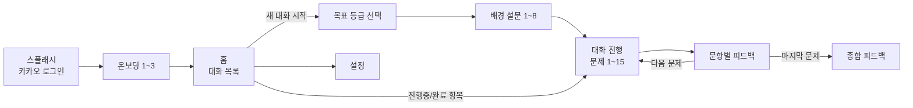

# 제품 개요

- 디자인: 팀 Figma 와이어프레임 (링크는 팀 채널 참고)

## 한 줄 소개

**Hello Eva**는 AI 시험관 Eva와 영어로 대화하며 OPIc 말하기 시험을 연습하는 모바일 앱입니다.

## 핵심 가치

1. **실전처럼 연습**: Eva가 음성으로 질문하고, 사용자는 음성으로 답합니다.
2. **나에게 맞는 질문**: 목표 등급과 배경 설문으로 실제 OPIc처럼 질문을 구성합니다.
3. **바로 확인하는 피드백**: 문항마다 예상 등급과 개선 방법을, 시험이 끝나면 종합 피드백을 줍니다.

## 화면 흐름

| 화면 (Figma 프레임) | 서버가 필요한가 | 관련 기능 |
|---|---|---|
| 스플래시 | O (로그인) | 001 |
| 온보딩 (1~3/3) | X (앱 내부 화면) | — |
| 대화 목록 조회(홈), 빈 상태 | O | 003 |
| 대화 생성 - 1 (목표 등급) | O | 002 |
| 대화 생성 - 2 (배경 설문 1~8) | O | 002 |
| 대화 상세 조회 - 1~5 (질문·답변·문항 분석) | O | 004, 005 |
| 대화 상세 조회 - 6~8 (종합 피드백) | O | 006 |
| 설정 | O (사용자 정보, 로그아웃, 탈퇴) | 001, 007 |

## 사용자

- OPIc 시험을 준비하는 한국어 사용자
- 카카오 계정으로만 가입합니다.

## 범위 밖 (1차 출시)

- 결제/유료 기능
- 카카오 외 소셜 로그인
- 웹 버전

## 기능 목록

| # | 기능 | 화면 | 문서 |
|---|---|---|---|
| 001 | 카카오 로그인·인증 (로그인, 로그아웃, 탈퇴) | 스플래시, 설정 | [001-auth](features/001-auth.md) |
| 002 | 대화 생성 (목표 등급 + 배경 설문) | 대화 생성 1~2 | [002-conversation-creation](features/002-conversation-creation.md) |
| 003 | 대화 목록 | 홈 | [003-conversation-list](features/003-conversation-list.md) |
| 004 | 대화 진행 (질문 듣기, 음성 답변) | 대화 상세 1~2, 5 | [004-conversation-session](features/004-conversation-session.md) |
| 005 | 문항별 피드백 | 대화 상세 3~4 | [005-question-feedback](features/005-question-feedback.md) |
| 006 | 종합 피드백 | 대화 상세 6~8 | [006-overall-feedback](features/006-overall-feedback.md) |
| 007 | 내 정보·설정 | 설정 | [007-user-settings](features/007-user-settings.md) |

## 결정된 것

- 질문 생성 방식: 대화를 만들 때마다 AI(Gemini)로 생성
- AI 제공자: 질문 생성·평가 Gemini(Vertex AI), 음성 합성 Cloud Text-to-Speech, 음성 인식 Cloud Speech-to-Text
- 음성 파일 저장소: Google Cloud Storage (공개 읽기)

## 아직 정하지 않은 것

- [ ] 음성 파일 보관 기간
- [ ] 프론트 스택 (API 코드 생성 여부 결정용)
